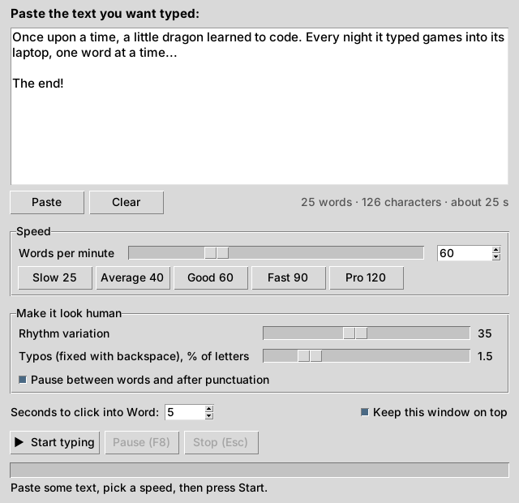
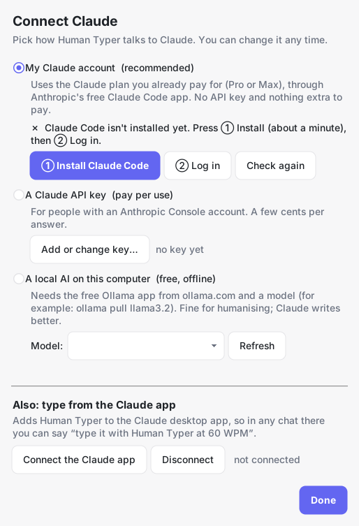
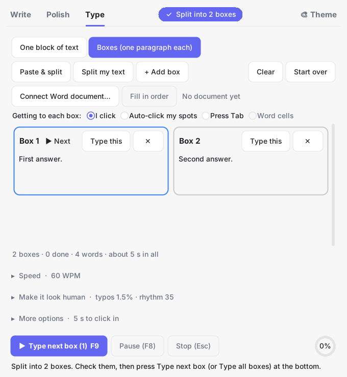
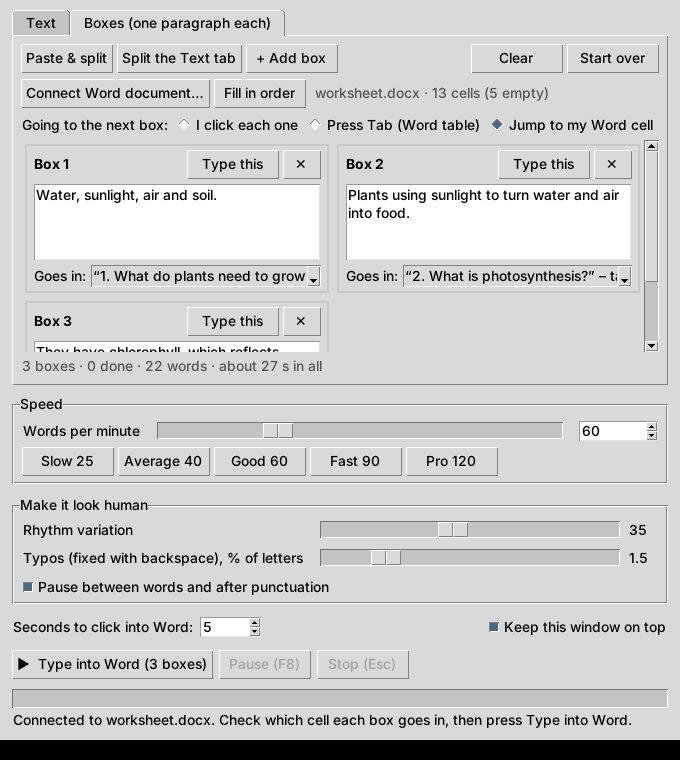
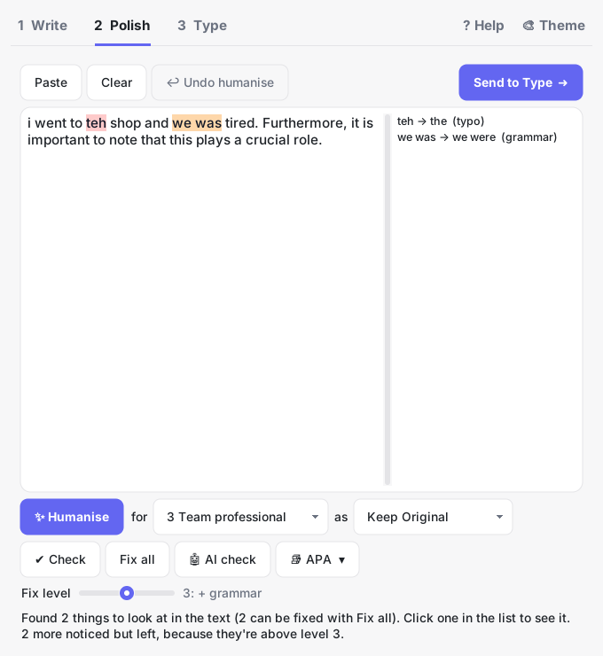
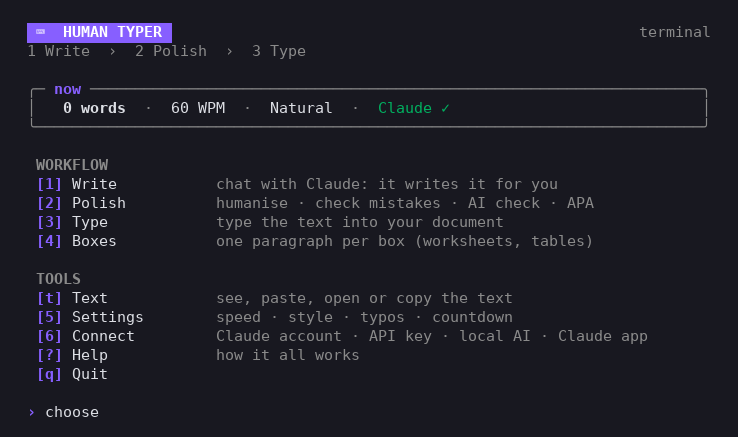
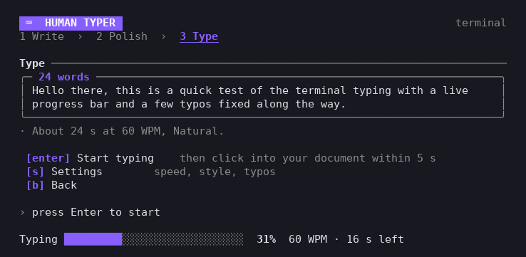

# Human Typer

Ask Claude to write something (or paste your own text), make it sound like you, choose how many **words per minute**
you want, then click into a Word document. Human Typer types the text out key by key, like a person would.

The app has three tabs, in the order you use them:

1. **Write** – chat with Claude, using your own Claude account.
2. **Polish** – humanise it for an audience, and check it for mistakes and AI-style habits.
3. **Type** – pick a speed and it types it into your document.

Lost? Press **? Help** (top right) for the whole app in five short steps.



## What it does

- **Write with Claude.** A chat box on the **Write** tab: ask Claude to write an email, an answer, notes or a story,
  and change it by chatting. It uses **your Claude account** (no API key). See [Write tab](#write-tab-chat-with-claude).
- **One-click workflow.** Press **Use this ➜** under Claude's answer and it's humanised, checked for mistakes, and
  put on the Type tab ready to go (or starts typing straight away, if you tick **Start typing**).
- **Any speed you like.** Use the slider (1–300 WPM), type a number into the box (up to 2000), or press a preset
  (25, 40, 60, 90 or 120). You can change the speed **while it's typing** and it speeds up or slows down straight away.
- **Random speed.** Tick **Random speed between** and pick two speeds, like 40 and 90. While it types, the speed keeps
  wandering between them: it speeds up for a few words, slows down, and now and then hits the very slowest or fastest.
- **Type in the background.** With Word, it can type while you keep using your computer. See
  [Typing in the background](#typing-in-the-background).
- **Pick a style.** Under **Make it look human**, press **Careful** (steady, very few mistakes), **Natural** (like
  most people) or **Messy** (uneven, lots of mistakes it fixes). Or set the sliders yourself.
- **Types like a real person.** Keys don't come at an even beat:
  - **Finger timing:** common letter pairs like "th" and "er" roll quickly, keys on opposite hands are quick, one
    finger moving to another key ("un", "my") is slower, and numbers and symbols take a reach.
  - **Bursts:** each word has its own pace, long words get a small hesitation first, and the first few words are a
    bit slower while it "warms up".
  - **Pauses:** a breath after commas and full stops, longer at new lines, and now and then a stop to "think".
- **Typos it fixes itself.** The mistakes people really make: the key next door, two letters swapped ("teh"), a
  doubled letter ("helllo"), a skipped letter ("hllo"), sometimes only noticed a letter later, and now and then a
  word started, rubbed out and started again. It always fixes them, so the finished text is exactly right. Set
  typos to 0 if you don't want any.
- **Choose what it gets wrong.** In **Always get these wrong**, list words and letters, like `the, because, e`. Those words get
  a mistake every time ("teh", "becuase") and those letters about half the time. With **Fix them** ticked, it notices
  and fixes them like the normal typos; untick it to leave the mistakes in the finished text.
- **✨ Natural tone.** Switch it on to rewrite the text in the box so it reads like everyday writing (handy for emails
  and meeting notes): contractions ("do not" → "don't"), plainer words ("utilize" → "use", "Furthermore," → "Also,"),
  simpler email phrases ("I hope this email finds you well" → "Hope you're doing well"), and normal punctuation instead
  of long dashes and curly quotes. Read it over before typing. Switch it off to get your original back (or press
  Ctrl+Z / Cmd+Z). It works offline with a list of rules, so it's a quick tidy-up, not a full rewrite in your voice:
  changing a few things yourself makes it sound most like you.
- **Speed stays exact.** Pauses and typos are included in the timing, so 60 WPM really takes as long as 60 WPM should
  (one "word" = 5 characters, the same rule typing tests use).
- **Boxes.** Split your text into paragraphs, one per box, and type each one into a different place in your
  document, or fill a Word table cell by cell. See [Boxes](#boxes-one-paragraph-per-box).
- **Auto-click spots.** Show it where each box goes on your screen, and it clicks there and types that box.
- **Connect a Word document.** Pick your worksheet, choose which table cell each paragraph goes in, and it jumps into
  each cell and types there. See [Connect a Word document](#connect-a-word-document-and-pick-the-cells).
- **Pause and stop.** Push the mouse into the **top-left corner** of the screen to stop, on any computer. On Windows,
  **F8** also pauses and resumes and **Esc** stops, even while Word is the active window. When you resume it counts
  down 3 seconds first, so you have time to click back into the document.
- The window shows how many words are in your text and about how long it will take.

## Download

Go to the **[Releases page](https://github.com/Xtroychaos/human-typer/releases/latest)** and download the file for
your computer:

| Your computer | Download |
| --- | --- |
| Mac with an Apple chip (M1, M2, M3, M4…, most Macs from 2021 on) | `HumanTyper-Mac-AppleSilicon.zip` |
| Older Mac with an Intel chip | `HumanTyper-Mac-Intel.zip` |
| Windows | `HumanTyper-Windows.exe` |
| Windows, to send to someone (many apps won't send .exe files) | `HumanTyper-Windows.zip` |

Not sure which Mac you have? Click the **Apple menu → About This Mac**. It says **Chip: Apple M…** or
**Processor: Intel**.

You don't need to install anything else.

### First time on a Mac

1. Double-click the downloaded zip to unzip it, then drag **Human Typer** into your **Applications** folder.
2. Open it. The Mac will say it can't check the app for malicious software, because the app isn't registered with
   Apple (that costs $99 a year). Click **Done**, then go to **System Settings → Privacy & Security**, scroll down and
   click **Open Anyway** next to Human Typer. On older macOS versions you can right-click the app and choose **Open**
   instead.
3. **Give it permission to press keys.** The first time you press Start, the Mac asks for this. Go to
   **System Settings → Privacy & Security → Accessibility** and turn on **Human Typer**. Then quit Human Typer and open
   it again. Without this the Mac quietly ignores the key presses and nothing gets typed.
4. **To stop on a Mac:** push the mouse into the **top-left corner** of the screen, or press the **Stop** button. (The
   F8 and Esc shortcuts are Windows-only, because on a Mac they can make the window crash.)

**If the Mac keeps asking for permission even though Human Typer is switched on:** every new download counts as a
new app to your Mac, so the old switch no longer works. Quit Human Typer (**Cmd+Q**), go to
**System Settings → Privacy & Security → Accessibility**, click **Human Typer** and press the **–** button to remove it
(remove every copy). Make sure the app is in **Applications**, not Downloads. Then open it, press Start, turn it on when
asked, and quit and reopen it once more.

### First time on Windows

1. Double-click **HumanTyper-Windows.exe**. If you got the **.zip** instead, right-click it → **Extract All…** →
   **Extract**, then open the **Human Typer** folder and double-click **Human Typer.exe**.
2. Windows may show **"Windows protected your PC"**, because the app isn't registered with Microsoft. Click
   **More info → Run anyway**.
3. Some antivirus programs are suspicious of any app that presses keys for you. If yours blocks it, allow it.

## How to use it

**With Claude:**

1. The first time, press **Connect Claude…** on the Write tab and follow the two steps. See
   [Connect Claude](#connect-claude).
2. On **Write**, ask Claude for what you need, like *"Write a short email asking my boss for Friday off"*. Keep
   chatting to change it (*"make it shorter"*, *"more casual"*).
3. Press **Use this ➜**. With **Humanise** and **Fix mistakes** ticked, it's rewritten to sound natural, checked, and
   put on the **Type** tab. (Want just part of the answer? Select that part of the chat first.)
4. Read it over, then press **Start typing** and click into your Word document before the countdown ends.

**With your own text:**

1. Go to **Type**, copy your text and press **Paste** (or click in the box and press Ctrl+V).
2. Pick your speed (click **Speed** to open it).
3. Press **Start typing**.
4. **Click inside your Word document** where the text should go, before the countdown ends (5 seconds by default).
5. Keep your hands off the keyboard and mouse until it finishes. To stop it, push the mouse into the top-left corner
   of the screen (or press **Esc** on Windows).

The app opens on the tab you used last.

## Write tab: chat with Claude


- Type a message and press **Send** (or **Enter**; **Shift+Enter** starts a new line). Claude's answer appears as
  it's written. Press **■ Stop** to stop it.
- Claude is told to reply with just the finished text (no "Here's your email:" line), so it's ready to use.
- **Use this ➜** sends Claude's last answer on. Tick what should happen to it:
  - **Humanise** – rewritten for the audience and format picked on the Polish tab.
  - **Fix mistakes** – spelling, grammar and so on fixed, at the fix level picked on the Polish tab.
  - **Start typing** – starts the countdown straight away, so click into your document.
- **Copy** copies the answer. **New chat** starts again.
- The line at the top says which AI it's using. **Connect Claude…** changes it.

Always read what Claude wrote before you use it. AI can get things wrong.

## Connect Claude

Press **Connect Claude…** (on the Write tab, or in the **Claude** / **🎨** menu). One window has every way of
connecting:



- **My Claude account (recommended).** Uses the Claude plan you already have (Pro or Max) through Claude Code,
  Anthropic's free command-line app. No API key, nothing extra to pay.
  1. Press **① Install Claude Code**. A Terminal (PowerShell on Windows) window opens and installs it, which takes
     about a minute.
  2. Press **② Log in**. Log in with your Claude account in the browser that opens, then come back.
  The window checks by itself and says **✓ Ready** when it's done. Claude only writes text here: it can't run
  anything on your computer.
- **A Claude API key (pay per use).** For an Anthropic Console account. Press **Add or change key…** and paste it. It's
  saved only on your computer (in `.human_typer.json` in your home folder, readable only by you).
- **A local AI (free, offline).** Needs [Ollama](https://ollama.com) and a model. Fine for humanising; Claude writes
  better. See [Local (free)](#local-free).
- **Also: type from the Claude app.** Adds Human Typer to the Claude desktop app, so you can ask Claude there to type
  something. See [Use it from Claude](#use-it-from-claude-connector).

## Boxes: one paragraph per box

On the **Type** tab, pick **Boxes (one paragraph each)** when the text needs to go into different places, like the
answer spaces on a worksheet, text boxes, or the cells of a table.



1. Copy your text and press **Paste & split**. Each paragraph gets its own box. (Paragraphs are split at blank lines.
   If there are none, each line gets its own box.) You can also press **Split my text** (splits the text from **One
   block of text**), type into the boxes yourself, press **+ Add box**, or remove a box with **✕**.
2. Choose how to get from one box to the next:
   - **I click into each box myself.** For text boxes or spaces spread around the page. Press **Type next box**, click
     into the matching spot in Word, and it types that box. Done boxes turn green with a ✓ and the next one turns blue.
     On Windows, you can instead click into the spot in Word and press **F9**, and it starts straight away.
   - **Auto-click my spots.** Works anywhere: Word text boxes, tables, Google Docs, websites. On each box, press
     **Set spot**. Human Typer hides, and you have 4 seconds to point the mouse at the place where that box should be
     typed (just point, don't click). Press **Show** to check a spot: the mouse jumps there. Then press
     **Click & type**: Human Typer gets out of the way, clicks each spot and types its box there, then comes back when
     it's done. Don't move the Word window or scroll the page after setting the spots, or the spots won't line up
     anymore. To stop, push the mouse into the top-left corner of the screen.
   - **Press Tab (for a table in Word).** Click into the first cell of the table and press **Type all boxes**. It types
     box 1, presses Tab to jump to the next cell, types box 2, and so on. (In the last cell of a Word table, Tab adds a
     new row.)
3. **Type this** on any box types just that box. **Start over** clears the ✓ marks.

## Connect a Word document and pick the cells

If your worksheet is a **table** in Word (for example questions in one column and answers in the other), Human Typer
can open it, show you every cell, and jump into the cells you pick by itself.



1. Save your document as a `.docx` file.
2. On the **Type** tab, pick **Boxes** and put your answers in the boxes (for example with **Paste & split**).
3. Press **Connect Word document…** and pick the file. Human Typer opens it in Word and reads its tables.
4. Under each box, **Goes in:** shows which cell it will be typed into. Each cell is named by the question next to it,
   like *“2. What is photosynthesis?” – row 3, cell 2*. Human Typer fills them in order into the empty cells to start
   with; change any of them, or pick **— skip this box —**. **Fill in order** sets them back to the empty cells in order.
5. Press **Type into Word**. Word comes to the front, and Human Typer clicks into each cell for you and types that box
   there. Keep your hands off the keyboard and mouse until it's done.

Good to know:

- It types **after** anything already in a cell, so a label like "Name:" stays (it adds a space after a `:`, or starts
  a new line otherwise).
- If you **pause** and click around, it jumps back into the right cell when you resume.
- It reads the cells from the saved file. If you change the table in Word, save and connect again.
- **Mac:** the first time, the Mac asks **"Human Typer wants access to control Microsoft Word"**. Click **OK**. If you
  clicked Don't Allow, turn it on in **System Settings → Privacy & Security → Automation → Human Typer → Microsoft Word**.
- **Windows:** if Word shows a yellow **Protected View** bar, click **Enable Editing** first.
- Text boxes and blank lines can't be picked this way. For those, use **I click each one**.

## Typing in the background

Normally Human Typer presses real keys, so Word has to stay in front and you can't touch the keyboard or mouse. Tick
**Type in the background** and it tells Word what to type directly instead. Word fills in live while you switch to other
apps, browse, or type somewhere else.

- **One block of text:** click in Word where the text should go, come back to Human Typer, and press
  **Start typing**. It types at Word's cursor, in the document at the front of Word.
- **Boxes:** works with **Word cells** (connect your document first). It moves Word's cursor into each cell without
  bringing Word to the front.
- It doesn't work with **I click**, **Auto-click my spots** or **Press Tab**, because those need real clicks and key
  presses. Turn the tick off to use them.
- It's under **More options**. Stop it with the **Stop** button. The mouse-corner stop and the F8/Esc keys are
  off in this mode, since you're using the mouse and keyboard yourself.
- **Mac:** the first time, click **OK** when the Mac asks to let Human Typer control Microsoft Word (or turn it on in
  **System Settings → Privacy & Security → Automation**). The Accessibility permission isn't needed for this mode.
- **Pin it to one spot** (ticked by default) keeps the text going exactly where it started, even if you click
  somewhere else in the same Word document, scroll, or switch apps. In Word cells mode, each cell is pinned when
  Human Typer moves into it. After a pause it carries on in the same place, with no need to click back in.
  With the pin on, Word's AutoCorrect doesn't change the words as they appear, and Word doesn't scroll along
  with the typing. Untick it to type at Word's cursor instead.
- Try not to type in that same document yourself, above the pinned spot, while it's typing.

## Polish tab: humanise and check

One box for the text, with everything to tidy it up. **Use this ➜** on the Write tab puts Claude's answer here, or
press **Paste**. When it's ready, press **Send to Type ➜**.



### ✨ Humanise

Rewrites the text so it sounds like a person would naturally write or say it, for the audience and format you pick,
while keeping what it says: names, dates, numbers, quotes and links stay as they are, and nothing new gets added.

- **for:** 1 Year 8 · 2 General audience · 3 Team professional · 4 Executive · 5 Finance analyst
- **as:** Keep Original · Meeting Notes · PowerPoint Slides · Speaker Notes

Press **✨ Humanise** and the text is rewritten in place as you watch (press **■ Stop** to stop). **↩ Undo humanise**
puts your original back. It uses the AI chosen in [Connect Claude](#connect-claude).

**Always read the result before you use it**, especially names, numbers and dates. AI can make mistakes.

#### Local (free)

Runs an AI model on your own computer: free, private, no account. Small models are good at making text sound natural
but are less reliable than Claude at keeping every detail exactly right, and they're slower.

1. Download **Ollama** from <https://ollama.com> and open it.
2. In Terminal, download a model (about 2 GB):

   ```bash
   ollama pull llama3.2
   ```

   With 16 GB of memory or more, `ollama pull qwen2.5:7b` (about 5 GB) does noticeably better.
3. In **Connect Claude…**, pick **A local AI on this computer**, press **Refresh** and pick the model.

### Check for mistakes

To check just one paragraph, select it first. Choose a **fix level** and press **✔ Check**:

| Level | What it fixes |
| --- | --- |
| 1 | Only mistakes that make a sentence confusing (a person has to judge these, so the checker leaves them) |
| 2 | + spelling, typos and doubled words ("teh", "the the"), in Australian spelling |
| 3 | + grammar: "they was", "could of", their/there, your/you're, then/than, it's/its, to/too, a/an |
| 4 | + punctuation, capital letters, missing apostrophes ("dont"), missing full stops, run-on sentences |
| 5 | + very casual words ("gonna") and the same word used twice close together |

Mistakes are highlighted and listed on the right (click one to find it). **Fix all** fixes them and
tells you how many it noticed but left because they're above your level. Things marked ⚑ are for you to decide.
It works offline, so it won't catch everything a person would.

### 🤖 AI check

Gives an **AI-style score out of 100** (Low / Medium / High) with the reasons, and highlights the
sentences that show the most AI habits (yellow = some, orange = many). It looks at the writing as a whole: polished
phrases ("paving the way", "reshaping the landscape"), no contractions, long and even sentences, formal linking words
("However,", "Ultimately,"), ", doing something" add-ons at the end of sentences, neat lists of three, an essay shape
ending in "In conclusion", no "I", lots of long words, and no slips at all.

It's a guide, not a verdict. In testing on pieces it hadn't seen, AI-written essays, emails and meeting notes scored
High, and casual and Year 8 writing scored Low, but a strong student's clean, formal essay scored **Medium** and an
AI-written story only scored Medium. No checker (including paid ones) can prove who wrote something, so use it to
start a conversation, never as proof on its own.

### 📚 APA 7 references

Press **📚 APA ▾**:

- **Fix the in-text references** tidies the citations already in the text: `(smith 2020)` → `(Smith, 2020)`,
  `(smith, jones and lee 2019)` → `(Smith et al., 2019)`, `(Australian Government, no date)` →
  `(Australian Government, n.d.)`, `(Smith 2020, p 12)` → `(Smith, 2020, p. 12)`.
- **Make a reference…** opens a window where you type a source (people or an organisation, year, title, website or
  publisher, link). It shows the APA 7 in-text citation and reference list entry as you type.
  **Insert after sentence** puts the citation at the end of the sentence you clicked in, before the full stop.
  **Add to reference list** collects sources, and **Put reference list at the end** adds them A to Z under
  "References". Remember to put titles in italics in your document.

## Use it from Claude (connector)

Human Typer can be a **connector** for the Claude desktop app, so Claude can write something with you and then have
Human Typer type it. It uses your normal Claude plan (no API key, no extra cost).

1. In Human Typer, press **Connect Claude…** (on the Write tab), then **Connect the Claude app**.
   This adds Human Typer to the Claude app's connector settings (and saves a backup of that file).
2. Quit the Claude app completely and open it again.
3. In a chat, ask Claude to write something, then say something like *"type it with Human Typer at 60 WPM"*.
   Human Typer comes to the front and counts down: click into your document, and it types it out.

Claude can also ask Human Typer to **stop**, check **how far it's got**, **check writing** (fix levels), give an
**AI-style score**, **fix APA citations** and make **APA references**. The **humanise** prompt (Claude's **+** menu)
rewrites text for an audience and format using the Humaniser instructions.

Keep Human Typer in your **Applications** folder (Mac) so the Claude app can always find it. If you move it, connect
again. To remove it: **Connect Claude… → Disconnect**.

## Terminal version

Prefer the keyboard? Human Typer also runs in a terminal, with everything the window has: chat with Claude, Polish
(humanise, check, AI check, APA), Type, Boxes, settings and Connect Claude.



- **Windows:** download `HumanTyper-CLI-Windows.exe` from the Releases page and double-click it (or run it from
  Command Prompt or PowerShell). It's also in `HumanTyper-Windows.zip`.
- **Mac:** with Human Typer in Applications, open **Terminal** and run:

  ```bash
  "/Applications/Human Typer.app/Contents/MacOS/Human Typer" --cli
  ```

- **From the code:** `python human_typer_cli.py` (or `python human_typer.py --cli`).

How to use it:

- Each screen has a short menu: type the letter or number in `[ ]` and press **Enter**.
- The text you're working on carries from step to step, like the tabs: **1 Write → 2 Polish → 3 Type**.
- **Write:** type a message and press Enter. `/use` sends Claude's last answer on (humanised and checked, if those
  are switched on in Settings) and offers to type it. `/paste` sends a long message over several lines, `/copy`
  copies the answer, `/new` starts a new chat and `/back` goes back to the menu.
- **Pasting text:** paste it (or type it), then type a line with just a full stop ( `.` ) and press Enter.
  **Text → From clipboard** and **Open a file** (.txt or .docx) work too.
- **Type** shows a countdown, then a progress bar that fills as it types:

  

- **Stop:** **Ctrl+C** stops anything (a reply, a rewrite, typing) and goes back a step. The mouse-corner stop works
  too, and on Windows **Esc** stops and **F8** pauses.
- **Boxes:** **Spots** asks you to point the mouse at each box's place and press Enter, which is simpler than in the
  window. **Word cells:** drag your .docx into the terminal window to give its path.
- Settings are saved, so they're the same next time. The terminal and the window share the Claude connection.
- Set `NO_COLOR=1` for plain text with no colours.

## Simple view

**Simple view** (in the Themes / 🎨 menu) hides everything except the Type tab's text box, the speed and
Start/Stop. Handy when Claude is sending the text anyway.

## Themes

Pick a look from the **Themes** menu (in the menu bar, or the **🎨 Theme** button at the top right of the clean
themes):

- **Clean Light** (the default), **Clean Dark**, **Midnight**, **Ocean**, **Sakura**, **Forest** – flat and minimal:
  - **No square corners:** rounded buttons, text boxes, fields, cards, scrollbars and sliders, round radio buttons
    and rounded checkboxes with a tick.
  - **A progress ring** instead of a straight bar: it fills up with the percentage in the middle, and spins during
    the countdown (with the seconds left) and while a rewrite is being written.
  - **The window's title bar** (where close and minimise are) takes the theme's colour on Windows 11, and goes
    dark or light to match on Windows 10 and Mac. The menu strip is tucked away (the 🎨 button has it).
  - **Neat and lined up:** every screen shares one left edge, one set of heading sizes and a thin line under
    the tabs. The ✓ message appears in the tab bar, so it never covers a button.
  - **No waiting:** tabs, buttons, menus, folding sections and messages respond straight away. The rounded parts
    are drawn as a few big pieces, so switching tabs is as quick as in Classic.
  - **Animations** that never hold you up: text boxes glow while you type in them; highlights and box borders
    fade; a ✓ message slides up when something finishes; the Start button pulses during the countdown.
  - **Speed**, **Make it look human** and **More options** start folded, with a summary in the heading (like
    "Speed · 60 WPM"). Click a heading to open it.
- **Classic** – the original grey look.

Untick **Animations** in the Themes menu to keep a clean theme without the motion. Your choice is remembered.

## Tips for Word

Word changes some things as you type. The text still ends up right, but it may look a little different:

- `"quotes"` become curly quotes, and `--` can become a dash.
- A line starting with `1.` or `-` can turn into a numbered or bulleted list.
- `(c)` becomes ©, and some words get auto-corrected.

To get an exact copy, turn these off in Word: **File → Options → Proofing → AutoCorrect Options** (on a Mac: **Word → Preferences → AutoCorrect**), then the
**AutoCorrect** and **AutoFormat As You Type** tabs.

Other tips:

- If you click somewhere else while it's typing, the letters go there instead. Pause it first.
- **Keep this window on top** keeps the app visible over Word, so you can always reach the buttons.
- It works in other programs too: Google Docs, Notepad, email and so on.

## Running it from the code (optional)

If you'd rather not use the downloaded app, you can run the Python file directly:

- **Mac:** install Python from <https://www.python.org/downloads/>, then double-click `start_mac.command`. In the
  Accessibility list, turn on **Terminal** instead of Human Typer.
- **Windows:** install Python (tick **"Add Python to PATH"**), then double-click `Start Human Typer (Windows).bat`.
- **Anywhere:** `pip install -r requirements.txt`, then `python human_typer.py`.

### Checking everything works

```bash
python -m unittest discover -s tests -v
```

This checks the typing (the finished text is always exactly right, even with typos and restarts, and it takes the
right time), the mistake checker, the AI check, APA, settings, and the link to Claude. GitHub runs it on every change.

To also test the whole app on screen (every tab and theme, the Write → Polish → Type workflow, and real key presses
into a text box), add `HT_GUI_TESTS=1`:

```bash
HT_GUI_TESTS=1 python -m unittest discover -s tests -v
```

## How the apps are made

Every time the code changes on `main`, GitHub builds the Mac and Windows apps on its own computers and puts them on
the Releases page (see `.github/workflows/build.yml`). The app icon is `icon.png`.
